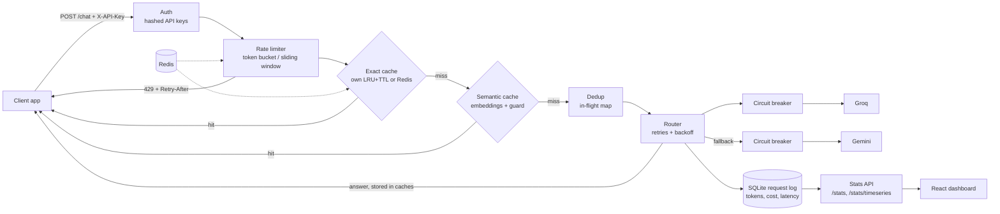

# LLM Gateway

[](https://github.com/rishitamimmithi/llm-gateway/actions/workflows/tests.yml)

A backend service that sits between apps and LLM providers (Groq, Gemini). Apps call the gateway instead of the
provider, and the gateway adds caching, rate limiting, failover, request deduplication, cost tracking and a live dashboard.

**Results in one line:** cut API cost by **75%** at a **71%** cache hit rate with **≤7%** false semantic hits
(held-out set), sustaining **779 req/s at 390 ms p95** on one worker (with a simulated 300 ms provider), 0 errors.

| what | measured | where |
|---|---|---|
| Cost cut on a realistic prompt mix | 75.1% (71.3% hit rate, 0 wrong answers seen) | [Money saved](#money-saved-on-a-realistic-prompt-mix) |
| Semantic false hits at threshold 0.94 | 22% → 3% with the guard (held-out set: 40% → 7%) | [False-hit measurement](#false-hit-measurement) |
| Throughput / p95 (200 users, 300 ms fake provider) | no cache 523 req/s / 340 ms; exact cache 779 req/s / 390 ms | [Load tests](#load-tests) |
| Failover with a wrong Groq key | 6/6 requests answered by Gemini, 0 failed | [Failover](#failover-and-circuit-breaker) |
| 50 identical concurrent requests | 1 provider call | [Request deduplication](#request-deduplication) |
| Adding a 4th cache node | 24.1% of keys move (vs 74.9% with `hash % N`) | [Consistent hashing](#consistent-hashing-sharded-exact-cache) |

## Architecture



What happens to one request:
1. **Auth**: the `X-API-Key` header is checked against hashed client keys (401 if wrong).
2. **Rate limit** per client: token bucket or sliding window, in memory or in Redis (one Lua script per check, so several gateway instances share limits). Over the limit: 429 with `Retry-After`.
3. **Exact cache**: same prompt (extra spaces ignored) → stored answer. My own LRU + TTL cache, or Redis, optionally sharded across Redis nodes with a consistent hash ring.
4. **Semantic cache** (optional): a prompt with the same meaning → stored answer, if similarity ≥ 0.94 *and* the guard agrees (same numbers, negation, to/from direction).
5. **Dedup**: identical prompts already waiting on a provider share that one call.
6. **Router**: providers in order (Groq, then Gemini), retries with exponential backoff + jitter, a circuit breaker per provider.
7. **Log**: every attempt, cache hit and shared request goes to SQLite with tokens, cost, latency and status; the dashboard reads it through the stats API.

## Quick start (Docker)

```
cp .env.example .env        # add GROQ_API_KEY / GEMINI_API_KEY and one client key in GATEWAY_API_KEYS
docker compose up --build
```

- Gateway: http://localhost:8000. Dashboard: http://localhost:8080
- No provider keys? Set `PROVIDER_ORDER=fake` in `.env` to try everything with a fake provider.
- Semantic cache in Docker: `SEMANTIC=true docker compose up --build` (PowerShell: `$env:SEMANTIC="true"; docker compose up --build`; adds CPU-only torch to the image), and `SEMANTIC_CACHE_ENABLED=true` in `.env`.
- Compose runs the gateway, Redis (shared rate limits + exact cache) and the dashboard (nginx serving the React build and forwarding `/stats` and `/health` to the gateway). The request log lives in the `gateway-data` volume.

```
curl -X POST localhost:8000/chat -H "X-API-Key: <your key>" -H "Content-Type: application/json" -d "{\"prompt\": \"hi\"}"
```

## Run locally (no Docker)
1. `python -m venv .venv` then activate it (Windows: `.venv\Scripts\activate`, Mac/Linux: `source .venv/bin/activate`)
2. `pip install -r requirements-dev.txt` (add `requirements-semantic.txt` for the semantic cache)
3. Copy `.env.example` to `.env`, add your Groq (and Gemini) key and at least one client key in `GATEWAY_API_KEYS`
4. `uvicorn app.main:app --reload`
5. Tests: `pytest` (419 tests; no keys or Redis needed: providers are faked and Redis is fakeredis)

All settings (timeouts, retries, breaker, limits, cache sizes, threshold) are environment variables listed in `.env.example`.

## Endpoints
| endpoint | what |
|---|---|
| `POST /chat` | `{"prompt": "..."}` → answer, provider, tokens, `cost_usd`, latency; cache hits say `"cache": "exact"/"semantic"` and `saved_usd` |
| `GET /stats` | totals per provider, cost, cache hits / misses / hit rate / money saved, deduplicated requests |
| `GET /stats/timeseries?minutes=60&bucket=60` | per-bucket requests, cache hits, failures, p50/p95 latency, spent and saved |
| `GET /health`, `GET /health/providers` | liveness; circuit breaker state per provider |

## Load tests
Locust (`loadtest/locustfile.py`), 200 users, 60 s per run, realistic prompt mix, one uvicorn worker,
fake provider taking 300 ms per call (so the test measures the gateway, not a free tier's rate limit).
Gateway and Locust on the same 12-core laptop. Details and how to run: `loadtest/results.md`.

| setup | requests | req/s | p50 ms | p95 ms | p99 ms | errors |
|---|---|---|---|---|---|---|
| no cache, no dedup | 30,990 | 523 | 310 | 340 | 370 | 0% |
| exact cache + dedup | 46,345 | 779 | 170 | 390 | 690 | 0% |
| exact + semantic cache + dedup | 22,365 | 378 | 360 | 1,200 | 2,100 | 0% |

- With no cache, 200 users can make at most ~570 req/s against a 300 ms provider; at 523 req/s and p95 340 ms the gateway adds about 10–40 ms.
- With the exact cache, hits skip the provider, so CPU (one Python process, plus Locust on the same machine) becomes the limit.
- The semantic run is slower because embeddings use the same CPU cores as the event loop.
- Hit rates in these runs (~99%) are much higher than real traffic would give; use the replay below for the realistic number.

Two bottlenecks the load test found and I fixed:

| problem | before | after |
|---|---|---|
| Each SQLite commit waited ~10 ms for the disk on the event loop → WAL mode | 64 req/s, p50 670 ms (50 users) | 128 req/s, p50 300 ms |
| Embeddings ran one prompt at a time (17.6 ms each) → micro-batching (~5 ms per prompt) | 137 req/s, p95 5.9 s | 378 req/s, p95 1.2 s |

## Failover and circuit breaker
Providers are tried in order (`PROVIDER_ORDER=groq,gemini`). Temporary errors (timeouts, 5xx, 429) are retried with
exponential backoff + jitter (respecting `Retry-After`); errors that won't change (bad key, bad request) aren't.
Each provider has a circuit breaker (CLOSED → OPEN after 3 failed requests in a row → HALF_OPEN after 30 s, one trial call).
With a wrong Groq key, 6/6 requests were answered by Gemini (HTTP 200): the Groq breaker opened, so later requests went
straight to Gemini, and a failed HALF_OPEN trial re-opened it. The key never appeared in logs or error messages.

## Rate limiting
Per client key, token bucket (default: burst of 10, then 0.2/s) or sliding window log (default: 12 per 60 s). With
`REDIS_URL` set, the state lives in Redis and each check is one atomic Lua script, using Redis's clock, so several gateway
instances share one limit. If Redis is down the limiter fails open and skips Redis for 5 s. Over the limit: HTTP 429 with
`Retry-After` and `X-RateLimit-Remaining`. Burst behaviour and the comparison are in `NOTES.md`.

## Caching
- **Exact cache**: same prompt (extra spaces ignored) gets the stored answer. Own LRU + TTL cache in memory, or Redis when `REDIS_URL` is set. Responses say `"cache": "exact"` and show `saved_usd`.
- **Semantic cache** (optional, `SEMANTIC_CACHE_ENABLED=true`, needs `pip install -r requirements-semantic.txt`): reuses an answer when a new prompt's embedding (`all-MiniLM-L6-v2`) is close enough to a stored one.
- **Guard** (`app/cache/guard.py`, on by default): before a semantic hit, both prompts must have the same numbers, the same negation, and the same word after "to / into / from / than"; otherwise it's a miss.
- Cut-off answers (hit the token limit) are never cached. `/stats` shows hits, misses, hit rate and money saved.

### False-hit measurement
123 hand-written question pairs (`eval/pairs.jsonl`): 50 with the same meaning, 73 that look alike but ask something different
(swapped direction, changed number, other entity, negation, ...). Run `python -m eval.false_hit_eval`; full table in `eval/results.md`.
"Before" = similarity threshold only, "after" = threshold + guard.

| threshold | hit rate before | false-hit rate before | hit rate after | false-hit rate after |
|---|---|---|---|---|
| 0.85 | 90% | 51% | 90% | 16% |
| 0.90 | 78% | 33% | 78% | 7% |
| 0.94 | 60% | 22% | 60% | 3% |
| 0.98 | 30% | 12% | 30% | 0% |

The guard rules were written while looking at those 123 pairs, so I also wrote 30 new pairs afterwards
(`eval/holdout_pairs.jsonl`, rules not changed after) to check it isn't just fitted to them (`eval/holdout.md`):

| threshold | hit rate before | false-hit rate before | hit rate after | false-hit rate after |
|---|---|---|---|---|
| 0.90 | 53% | 60% | 53% | 13% |
| 0.94 | 40% | 40% | 40% | 7% |

What still gets through: antonyms ("healthy" vs "unhealthy", "most" vs "least"), swapped numbers
("12 divided by 4" vs "4 divided by 12"), and different names with a similar meaning (Slovakia vs Slovenia).

Embedding similarity alone can't tell "convert 5 miles to km" from "convert 5 km to miles" (similarity 0.99), so the
look-alike set is a stress test: real traffic has far fewer near-misses, but these are exactly the wrong answers a cache must not give.

### Money saved on a realistic prompt mix
300 requests replayed one at a time through the gateway (real Groq `openai/gpt-oss-20b` calls, exact + semantic cache
at 0.94 with the guard, fresh database). The mix (`loadtest/prompt_mix.json`): 30 popular questions asked with a
Zipf-like popularity (the top one ~19% of traffic) in 3 different wordings, 8 look-alikes of popular questions
("Convert 10 INR to USD" next to "Convert 10 USD to INR"), and 30 one-off questions asked once.
Run `python -m loadtest.savings_replay --url http://localhost:8000 --key <client key>`.

| requests | provider calls | exact hits | semantic hits | hit rate | wrong semantic hits | spent USD | saved USD | cost cut |
|---|---|---|---|---|---|---|---|---|
| 300 | 86 | 158 | 56 | 71.3% | 0 | 0.0135 | 0.0408 | 75.1% |

- 104 different prompts were sent but only 86 reached a provider: 18 paraphrases were answered by the semantic cache the first time they appeared.
- All 7 look-alikes that came up went to the provider the first time (no wrong answer). "Wrong semantic hits" only
  counts hits for a question that was never answered before, so it's a lower bound, not a full false-hit check (that's the eval above).
- The mix is synthetic: the hit rate depends on how repetitive the traffic is. A support bot with a few FAQs will look like this;
  a coding assistant with mostly unique prompts will see far fewer hits. Dollar amounts are tiny because the model is cheap; the % is what carries over.

## Request deduplication
If identical prompts (extra spaces ignored) arrive while one is already waiting on a provider, they all share
that one call (`app/core/dedup.py`). Shared responses say `"deduplicated": true`, cost $0 and show `saved_usd`;
`/stats` counts them under `cache.deduplicated`. If the call fails, every waiting request gets the same 503
instead of each retrying. Turn off with `DEDUP_ENABLED=false`.

Burst of 50 identical requests, fake provider taking 0.5 s (`python -m loadtest.dedup_burst`):

| run | requests | provider calls | shared | p50 ms | p95 ms |
|---|---|---|---|---|---|
| dedup on | 50 | 1 | 49 | 542 | 558 |
| dedup off | 50 | 50 | 0 | 527 | 549 |

Same latency, 49 fewer provider calls. Against a running gateway: `python -m loadtest.dedup_burst --url http://localhost:8000 --key <client key>`.

## Consistent hashing (sharded exact cache)
With `CACHE_NODES=redis://host1:6379/0,redis://host2:6379/0` (2+ URLs) the exact cache is split across the Redis
nodes by a consistent hash ring (`app/core/consistent_hash.py`, 100 virtual nodes per node). Keys moved when the
node count changes, 100,000 keys (`python -m eval.ring_moves`):

| change | ideal | consistent hashing | hash % N |
|---|---|---|---|
| 3 -> 4 nodes | 25% | 24.1% | 74.9% |
| 4 -> 5 nodes | 20% | 19.9% | 80.1% |
| 4 -> 3 nodes | 25% | 24.1% | 74.9% |
| 10 -> 11 nodes | 9% | 8.9% | 90.8% |

Virtual nodes even out the load: with 4 nodes the busiest one holds 41% of keys with 1 virtual node each,
28.7% with 100 and 26.0% with 500 (ideal 25%).

## Dashboard
React (Vite + recharts) app in `dashboard/`, refreshing every 5 s: requests over time (provider answer / cache hit /
shared / failed), provider latency p50 and p95, money spent vs saved, and each provider's circuit breaker state.
Time ranges: 15 min, 1 hour, 6 hours, 24 hours. With Docker it's at http://localhost:8080; without:

1. Start the gateway (`uvicorn app.main:app`, port 8000)
2. `cd dashboard`, `npm install`, `npm run dev`, open http://localhost:5173
   (gateway on another address: `GATEWAY_URL=http://host:port npm run dev`)

## Project layout
```
app/
  main.py           routes, auth + rate-limit dependency, cache -> dedup -> router flow
  config.py         every setting, checked at startup
  core/             my own building blocks: lru_cache, token_bucket, sliding_window, redis_limiters,
                    circuit_breaker, retry, router, dedup, consistent_hash, cost, api_keys
  cache/            exact (memory / Redis), sharded, semantic, guard
  providers/        base interface, groq, gemini, fake (load tests)
  db/logger.py      SQLite request log + stats queries
tests/              pytest, one file per component
eval/               false-hit pairs, hold-out set, evaluation scripts
loadtest/           Locust file, savings replay, dedup burst
dashboard/          React dashboard (+ Dockerfile, nginx.conf)
NOTES.md            design decisions: what I chose, the alternatives, and why
```

## Limits I know about
- Dedup is per gateway instance; two instances can each make one call for the same prompt.
- `/stats`, `/stats/timeseries` and `/health` need no API key yet; lock them down before deploying publicly.
- The cache is shared across all client keys (fine while all clients are mine).
- The guard misses antonyms and swapped numbers; a small cross-encoder re-check would be the next step.
- SQLite and one uvicorn worker are fine for a laptop; PostgreSQL and several workers behind a load balancer are the next step for more traffic.

## Roadmap
- [x] Basic proxy with logging
- [x] Second provider, fallback, circuit breaker, cost tracking
- [x] Per-key rate limiting (token bucket or sliding window, optional Redis)
- [x] Exact cache, semantic cache, false-hit test set, money saved on a realistic prompt mix
- [x] Request deduplication + consistent hashing for cache nodes
- [x] React dashboard
- [x] Load testing, Docker, CI
- [ ] Stretch: streaming (SSE), cost-aware routing, OpenTelemetry tracing, Ollama provider
